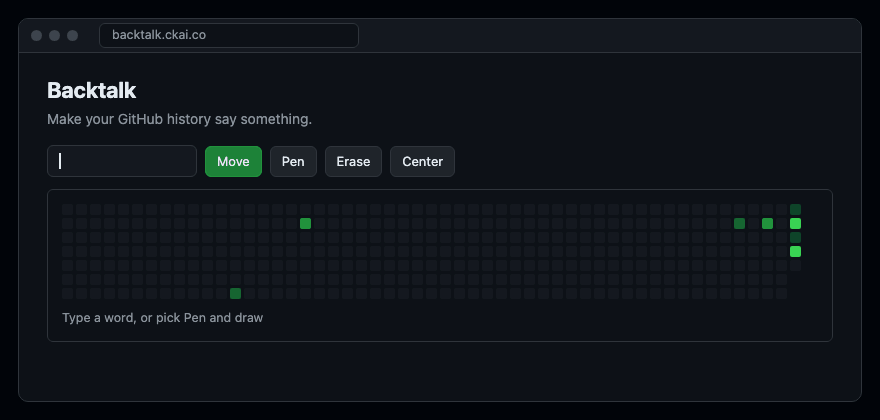

# Backtalk

**Make your GitHub history say something.**



My contribution graph says [POOP](https://github.com/ckaico). Yours can say anything.

Type a word or draw it pixel by pixel, see it on your real graph, drag it where you want, then
paint it. Backtalk puts every commit in a new repo of its own, dated in the past on purpose.
Your real work is never moved, hidden or rewritten.

**[Open the editor at backtalk.ckai.co](https://backtalk.ckai.co)**

## Make your own

You need Python 3 and the [GitHub CLI](https://cli.github.com) (`gh`), signed in. Nothing else to
install.

```bash
git clone https://github.com/ckaico/backtalk && cd backtalk
python3 backtalk.py fetch YOUR_LOGIN
python3 backtalk.py plan POOP --calendar calendar.json --email YOUR_GITHUB_EMAIL
open out/preview.html
```

The preview is your actual graph with the art on top. Drag it, nudge it with the arrow keys, draw
with four shades, or switch to a smaller font to move it up and down. It gives you the exact
command for what you see. When it looks right:

```bash
python3 backtalk.py paint out/manifest.json --repo ../my-art --name "Your Name"
cd ../my-art
gh repo create my-art --public --source . --push
cd - && python3 backtalk.py verify out/manifest.json YOUR_LOGIN
```

## How it works

The graph is one column per week, Sunday on top. Letters are 7 squares tall, 5 with
`--font small`, or 4 with `--font mini`, the smallest that still reads. The smaller fonts leave
room to move the word up or down with `--row`.

`plan` reads your graph and picks the widest stretch of past weeks with nothing in it, so the art
never lands on your real work. Pass `--start` with a Sunday to place it yourself.

Each square gets as many commits as your busiest real day, so the word comes out in the darkest
green and your real days read lighter. `--per-cell` changes that.

Commits are dated 12:00 UTC, so they land on the right day for any time zone from UTC-11 to
UTC+11.

Running `paint` twice is safe. Each commit carries a `backtalk-cell` trailer and squares already
painted are skipped. It won't touch any repo it didn't create for that piece of art.

The art repo's README says the dates are set on purpose and don't record real work.

## Will it show up?

GitHub counts a commit when its email is on your account, it's on the default branch, and the repo
isn't a fork. Private repos only show if private contributions are turned on. GitHub picks the
shades from your own activity and can take a while to recount, so colors may differ a little from
the preview.

## Is this cheating?

It's a drawing. Anyone who opens the art repo sees what it is, and so does anyone who reads the
dates. Use it for a laugh, not to look busy.

## License

MIT
